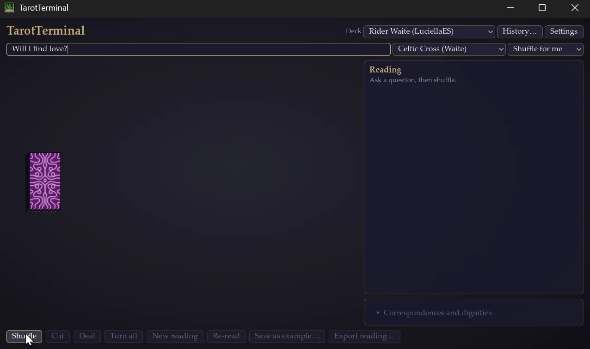

# TarotTerminal: a Golden Dawn tarot reader

A Golden Dawn tarot reader that runs on your own computer.

You ask a question and the app shuffles and deals a spread. It then works out, in code,
each card's Golden Dawn correspondences (path, Hebrew letter, sephira, decan, court rank)
and its elemental dignity from its neighbours. Those facts and your question go to a
language model running on your machine, which writes the reading. The model only
interprets: it never decides an attribution or a dignity.

Nothing leaves your computer unless you point the app at an online model yourself.



*Shortened, with the writing sped up. This reading took 16 seconds with
`gemma4:26b-a4b-it-qat` on a 16 GB card.*

## Contents

- [What you need](#what-you-need)
- [Getting started](#getting-started)
- [Doing a reading](#doing-a-reading)
- [Spreads](#spreads)
- [Decks](#decks)
- [Your own card meanings](#your-own-card-meanings)
- [Example readings](#example-readings)
- [History and export](#history-and-export)
- [Settings](#settings)
- [Suggested settings](#suggested-settings)
- [Speed and hardware](#speed-and-hardware)
- [Where things are kept](#where-things-are-kept)
- [Running from source](#running-from-source)
- [Sources and credits](#sources-and-credits)

## What you need

- **Windows**, for the ready-made build. From source, it runs anywhere Godot 4.7 runs.
- **A local model server.** [Ollama](https://ollama.com) is the easiest; LM Studio,
  llama.cpp's server and any other server with an OpenAI-compatible API work too.
- **A graphics card with about 12 GB of memory or more** for a good reading model.
  Smaller cards work with smaller models, less well. [Suggested settings](#suggested-settings)
  has a model for each size of card.
  - Written and tested with `gemma4:26b-a4b-it-qat` in Ollama.
  - On a 12 GB card (an RTX 4070 SUPER), a 3-card reading took about 50 seconds and a
    10-card spread about 90.

## Getting started

1. **Install Ollama** and download a model, for example:

   ```
   ollama pull gemma4:26b-a4b-it-qat
   ```

   Pick the one for your card from [Suggested settings](#suggested-settings).

2. **Unzip TarotTerminal** anywhere and run `TarotTerminal.exe`.
3. **Read the notice** that appears the first time and press **I agree**. TarotTerminal
   is for entertainment and reflection; it isn't advice of any kind.
4. **Open Settings** (top right). The server is already set to Ollama on this computer
   (`http://localhost:11434/v1`). Press **Test**: the model list fills in, and the
   server's context window is shown. Choose your model and press **Save**.

Ollama on another computer works too: put its address in **Server**, for example
`http://my-pc:11434/v1`.

## Doing a reading

1. **Type your question** in the box at the top and choose a spread from the menu beside
   it. Yes/no questions get a clear leaning (yes, no or not yet); open questions get a
   fuller reading.
2. **Press Shuffle.** The reader first weighs your question: the deck glows and a timer
   runs, and Deal waits. This takes a second or two, or longer when the model has to load
   first. A question about doing harm is refused and no card is dealt. If the model can't
   say, the reading goes ahead and a note under it says so. Then:
   - **Cut** fans the deck; click a card in the fan to cut there.
   - **Deal** lays the top cards face down in the positions.
   - Or **click the deck** to fan it face down and pick your cards yourself, one per
     position, in order.
3. **Turn the cards**, one at a time by clicking them or all at once with **Turn all**.
   When the last card is up, the reader starts. You see what it is doing ("studying the
   spread", "thinking it over") until the reading streams in.
4. **Read it.** Each position is read in turn, then a synthesis answers the question,
   drawing on the dignities and the patterns of the spread (which elements are strong
   or missing, trumps against minor cards, repeated numbers, the courts).
   - Under the reading, a line shows the tokens used and how many seconds it took.
   - **Correspondences and dignities**, under the reading, lists the facts the reader
     was given.
   - **Click a card** to see it large with its correspondences.
5. **Re-read** reads the same cards again. Change the model in Settings first to compare
   models: the question is weighed again, and each reading is kept in the history. The
   seconds shown leave out the weighing, so loading the model doesn't count.
6. **New reading** clears the table for the next question.

**Using your own deck:** set **Cards** (beside the spread menu) to **My own cards**.
Shuffle and lay out your physical deck and press **Lay out**. Once the reader has weighed
your question, click each position and say which card is there. You can type a name ("seven wands"), a short code ("7w",
"kp" for the King of Pentacles, "aw" for the Ace of Wands) or a trump's number ("16").
The reading starts when the last card is in.

**Keys:**
- **Space or Enter:** the next step (shuffle, deal, turn the next card).
- **Ctrl+Enter:** turn every card.

**On the table:** the mouse wheel zooms, a middle-drag pans, and a middle double-click
shows the whole spread again.

**Elemental dignities:** the Golden Dawn reads no reversed cards. Instead, each card is
strengthened or weakened by the elements of its neighbours in the spread:
- the same element is strong;
- Fire with Water, or Air with Earth, are contrary and weaken each other;
- every other pairing is friendly.

A card comes out well dignified, ill dignified or neutral, and the reading says why.

**Questions about harm:** the reader won't lay out cards for a question about killing,
hurting or abusing anyone, yourself included. It says so instead of dealing.

## Spreads

| Spread | Cards | |
|---|---|---|
| Past, Present, Future | 3 | |
| Celtic Cross (Waite) | 10 | Waite's 1911 order, no significator. Dignities run along the lines of the cross and the staff. |
| Rainwolf Planetary Orbit | 10 | Dignities run along the spiral. |
| One card | 1 | With no neighbours, the card is neither well nor ill dignified. |

The menu remembers the spread you chose last.

**Designing your own:** Settings → Spreads → **Design…** opens the spread designer in
a window of its own.
- **Add cards:** double-click the table (up to 12; more than that overloads the reader).
- **Move them:** drag; hold Shift to snap to a grid, or Alt to keep a straight line.
- **Turn them:** Ctrl+drag, or drag the knob above a selected card, in eighths of a turn.
- **Dignity lines:** drag from the glowing ring round a card onto another card. Those
  two then count as neighbours.
- **Crossing cards:** drop a card on another to lay it over it, as the Celtic Cross's
  crossing card lies over the first.
- **Fill in the fields:** the spread's name and length, and each position's name and
  meaning.
- **Save:** waits until nothing overlaps or covers the deck. The spread then appears in
  the menu.

Spreads are saved as `.json` files in the `spreads` folder and can also be written by
hand. The format is in [docs/custom_spreads.md](docs/custom_spreads.md), which a build
also carries as `spreads/README.md`.

## Decks

Decks live in the `decks` folder next to `TarotTerminal.exe`, one folder per deck.
Choose one from **Deck** at the top of the window. The list looks again each time it
opens, so a deck added while the app runs shows up straight away.

**Adding a deck:** make a folder in `decks` with an image for each card, numbered as
below, and a card back:

```
decks/
  My Deck/
    0.jpg ... 77.jpg
    back.jpg
    deck.json        (optional)
```

- **Images:** JPEG, PNG or WebP. Leading zeros are fine (`07.jpg`).
- **Size:** card images are shown at most 1440 pixels tall, so larger files gain
  nothing. Make the back the same size as the cards. With no back, the app draws its
  own.

| Numbers | Cards |
|---|---|
| 0–21 | The trumps, the Fool to the World (Strength is 8, Justice 11) |
| 22–35 | Wands: Ace, 2–10, Page, Knight, Queen, King |
| 36–49 | Cups, in the same order |
| 50–63 | Swords |
| 64–77 | Pentacles |

For example: the 7 of Wands is 28, the Page of Wands 32, the Ace of Cups 36, and the
King of Pentacles 77.

**Orphalese Tarot decks** use the same numbering. A deck folder from Orphalese's
`Packs` folder can be copied into `decks` as it is; its XML files are ignored. BMP and
GIF decks need converting to JPEG or PNG first.

**`deck.json`** is only needed when a deck differs from the numbering above. Include
only the fields you need:

```json
{
  "name": "My Deck",
  "back": "card-back.png",
  "index_overrides": {"8": 11, "11": 8},
  "suit_order": ["wands", "cups", "swords", "pentacles"],
  "court_order": ["page", "knight", "queen", "king"]
}
```

- `name`: the name shown in the menu (otherwise the folder's name).
- `back`: the back image, if it isn't called `back`.
- `index_overrides`: individual cards, as card number → file number. The example is for
  decks that number Justice 8 and Strength 11, as many older and Orphalese decks do.
- `suit_order`: which suit fills files 22–35, 36–49, 50–63 and 64–77, for decks that
  put Swords before Cups, for instance.
- `court_order`: the order of the four court cards at the end of each suit.

To check a new deck, see that the cards come up right on the table, or run the deck
check from source (see [Running from source](#running-from-source)).

## Your own card meanings

Every card comes with two meanings: Waite's (*The Pictorial Key to the Tarot*, 1911)
and the Golden Dawn's (*Book T*). You can add your own, and the reader gives them the
most weight, so readings come out in your terms.

Put them in `local/meanings.json`, next to `TarotTerminal.exe`:

```json
{
  "0": {"personal": "A leap before looking; trust in the new."},
  "16": {"personal": "What was built on a false footing falls."}
}
```

- **Keys** are card numbers, the same as the deck files.
- **`personal`** is your reading of the card.
- **`gd` or `waite`** there replace the shipped text for that card.
- **Fields you leave out** keep the shipped text.

The file is read at start-up, so restart after changing it. The full guide is in
[docs/card_meanings.md](docs/card_meanings.md), also in a build as
`local/README.md`.

## Example readings

The reader writes in the style of up to three example readings you choose.
- **Saving one:** after a reading, **Save as example…** opens it for editing, so you
  can shape it into the kind of reading you want.
- **Managing them:** Settings → Examples → **Manage…** lists, edits and deletes your
  examples.
- **Nothing is sent until you save one.** Then the examples go with every reading.

## History and export

- **History:** every finished reading is saved. **History…** (top right) lists them,
  newest first, each with its model.
  - **Open** lays a reading out on the table again, face up.
  - **Re-read** opens it and reads its cards again with the model now in Settings, as a
    new reading.
  - **Export** saves it as a Markdown file.
  - **Delete** removes it (press twice).
  - Settings → History turns saving off.
- **Export reading…** saves the reading on the table as a Markdown file, with the
  question, the cards, their correspondences and dignities, and the reading itself.

## Settings

| Setting | What it does |
|---|---|
| Server | The model server's address, up to `/v1`. Default: Ollama on this computer. **Test** checks it and lists its models. |
| API | **Automatic** uses Ollama's own API when the server is Ollama, otherwise the OpenAI-compatible one. |
| Model | Which model reads. Empty uses the first one the server lists. |
| API key | For servers that need one; local servers usually don't. |
| Temperature | Lower is steadier, higher is freer (default 0.8). |
| Max tokens | The most the model may write, thinking included (default 8,192). |
| Context window | How much the model holds at once: prompt, thinking and reading (default 16,384). With Ollama the app asks for this size. Other servers must be set to it themselves. |
| Timeout | Give up when the server is silent this long (default 300 seconds; loading a model can be slow). |
| Critique | A second pass checks each reading answered the question and addressed every ill-dignified card, and revises it if not. |
| Thinking | Lets a thinking model reason before it writes. Off is faster. The question is always weighed without it. |
| Examples | Your example readings (see above). |
| Interface size | 100% to 200%, for high-resolution screens or bigger text. |
| Deck folder | Where decks are found. **Default** is the `decks` folder next to the app. |
| History | Keep every finished reading. |
| Spreads | Opens the spread designer. |

If a reading would not fit the context window, the app warns before sending it. If the
model runs out of room, the reading is marked as cut off, with **Retry**.

## Suggested settings

| Your card | Model in Ollama | Thinking | Context window | Max tokens |
|---|---|---|---|---|
| 16 GB | `gemma4:26b-a4b-it-qat` | On (Off is twice as fast and nearly as good) | 16,384 | 8,192 |
| 12 GB | `gemma4:12b-it-qat` | Off | 16,384 | 8,192 |
| 8 GB | `gemma4:e4b-it-qat` | Off | 8,192 | 3,000 |
| 4 to 6 GB | `qwen3.5:4b` | On | 16,384 | 8,192 |

Leave Temperature at 0.8.

These come from 153 readings by 14 models: four questions on the same cards for every
model, checked for whether each card was read, its dignity told right, no card invented
and the question answered. How good a reading is, only you can say; **Re-read** lets you
compare models on your own cards.

- **Gemma 4** kept to the facts best. In 46 readings, the three sizes above had three
  faults between them.
- **`mistral-nemo`** (12 GB) is quick and sound, and **`mistral`** (8 GB) is quicker still,
  if plainer and now and then wrong about the elements.
- **`ministral-3`** writes the most vividly, but often runs to twice the length asked for
  and brings in cards that weren't dealt.
- **`llama3.2:3b`**, **`phi4-mini`** and **`ministral-3:3b`** are too small for this: they
  skip cards, invent them, or don't answer. `phi4-mini` also turns harmless questions away.

The models were timed on a 16 GB card, so the smaller cards' rows say what should fit, not
what was timed on one. Run `ollama ps` during a reading to see. If a model won't fit, take
the row below.

## Speed and hardware

A reading takes as long as the model needs to think and write. Longer spreads ask for
longer readings: about 300 to 500 words for three cards, and 700 to 1,000 for the Celtic
Cross (most models run to about 1,300).

If readings are slow:

- **Keep the whole model on the graphics card.** Run `ollama ps` during a reading.
  Anything less than "100% GPU" means part of the model runs on the processor, which is
  much slower for most models. (`gemma4:26b` is an exception: it still runs at about 100
  tokens a second on a 16 GB card with a sixth of it on the processor.) A smaller model,
  or a smaller **Context window**, may fit.
- **A Context window of 8,192 is enough with Thinking off**, for up to ten cards; set Max
  tokens to about 3,000 with it. With Thinking on, keep 16,384: a ten-card reading takes 8,000 to
  11,000 tokens in all, and some models ran out of room at 8,192.
- **Close other programs that use the graphics card**, such as an image generator with
  a model still loaded.
- **Turn Thinking off.** The model then writes straight away. Readings are quicker,
  though often less considered.
- **The first question is slower**, while the model loads. That happens as the question is
  weighed, so the seconds shown under a reading leave it out.

## Where things are kept

**Next to `TarotTerminal.exe`:**
- `decks/`: card decks.
- `spreads/`: spreads you design or write.
- `local/meanings.json`: your own card meanings.

**In `%APPDATA%\Godot\app_userdata\TarotTerminal\`:**
- `settings.json`: the app's settings, including that you agreed to the notice.
- `llm.json`: the model server settings.
- `history/`: saved readings.
- `read_examples.txt`: your example readings.
- `window.json`: where the window was last closed. The app reopens it there.

Delete `settings.json` to see the first-run notice again.

## Running from source

You need [Godot 4.7](https://godotengine.org). Open the project in Godot, or run
`godot --path .`.

| Task | Command |
|---|---|
| Unit tests | `godot --headless --script tests/run_tests.gd` |
| Interface test (fake model) | `godot --headless --script tests/ui_smoke.gd -- --readings=4` |
| Check every deck | `godot --headless --script tools/deck_check.gd` |
| See a deck in order | `godot --path . res://tools/deck_viewer.tscn` |
| Check the card data | `godot --headless --script tools/verify_data.gd` |
| A reading in the terminal | `godot --headless --script tools/read.gd -- --question="..."` |
| Shrink decks to JPEG | `godot --headless --script tools/convert_decks.gd -- --dry-run` (without `--dry-run`, it replaces the originals) |
| Windows build | `bash tools/build_windows.sh` (to `build/windows/`) |

The build packs the code, data and prompts into `TarotTerminal.exe`. It copies the
decks marked `"distributable": true` in their `deck.json` and adds the `spreads` and
`local` folders with their guides.

The prompts are plain text in `prompts/`, so the reader's instructions can be changed
without touching code. CLAUDE.md has the design notes.

## Sources and credits

The Golden Dawn attributions, the court card mapping (the RWS King as the GD Prince,
the Page as the Princess) and the invisible paths of the court cards follow:

> Hulse, David Allen. *The Key of It All: An Encyclopedic Guide to the Sacred Languages
> & Magical Systems of the World*. Book Two: *The Western Mysteries*. 2nd ed. St. Paul,
> MN: Llewellyn Publications, 2000.

Elemental dignities follow the Golden Dawn's *Book T*. The Celtic Cross follows A. E.
Waite, *The Pictorial Key to the Tarot* (London: William Rider & Son, 1911). The
Planetary Orbit spread is Rainwolf's
(https://tarotforum.net/threads/planet-spread.62323/).

Correspondences are facts of the tradition and are stored as data. The card meanings
that ship are the traditional ones, Waite's and the Golden Dawn's.

The "Rider Waite (LuciellaES)" deck is Luciella Elisabeth Scarlett's restoration of the
Rider-Waite-Smith cards, released under CC0
(https://luciellaes.itch.io/rider-waite-smith-tarot-cards-cc0). The other decks are the
author's own.

TarotTerminal is for entertainment and reflection only.

## License

- **The app** (code, prompts, spreads and docs) is under the [MIT License](LICENSE),
  © 2026 Sasazaki Software (Reiji Kitsuoka). Use it, change it, or borrow from it as
  you like; keep the copyright line and license text with what you take.
- **The author's ten decks** (Baroque, Dark Fantasy, Etching, HD, Mystical, Pastel,
  Steampunk, Synthwave, Ukiyoe, Vibrant) are under
  [CC BY 4.0](https://creativecommons.org/licenses/by/4.0/): share and adapt them,
  crediting "Decks by Reiji Kitsuoka (Sasazaki Software)".
- **The Rider Waite (LuciellaES) deck** is CC0, as its author released it.
- **The Godot Engine**, which TarotTerminal is built with, is under the MIT License.
  Settings → **Licenses…** shows its license and those of the libraries it includes.
